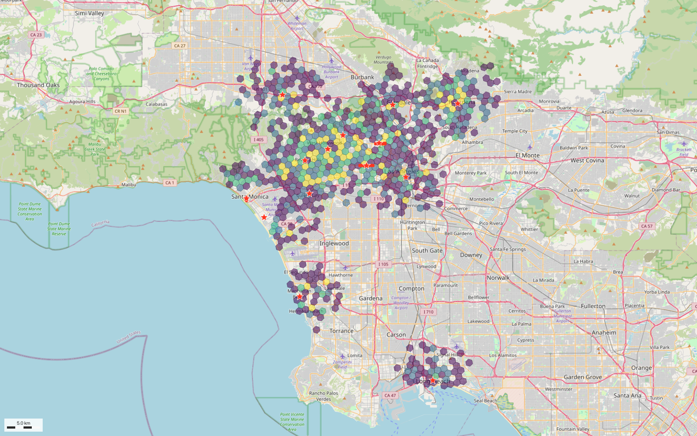
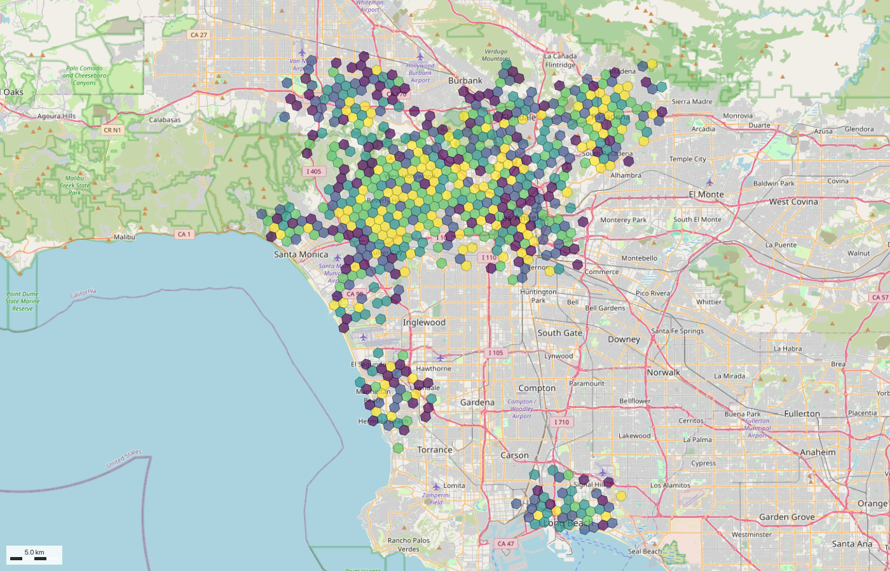

# Databricks SQL for RustGIS

**Map your Databricks lakehouse in [RustGIS](https://rustgis.app), with no exports.** This plugin connects the fast,
open-source RustGIS desktop to a **Databricks SQL warehouse**:
- **Browse:** Unity Catalog for spatial tables.
- **Load:** tables with your own parameters, or as **dynamic layers** that re-query only what's in view as you pan and zoom.
- **Query:** turn any `SELECT` into a layer.
- **Ask Genie:** plain-English questions, when your account has [Genie](https://docs.databricks.com/genie/). Genie writes
  and runs the SQL; the plugin maps the result and shows Genie's insight, recommendations and follow-up ideas.

`GEOMETRY` / `GEOGRAPHY`, H3 and Databricks spatial SQL all run on the warehouse.


*Los Angeles, queried live from a Databricks SQL warehouse: customers aggregated to H3 resolution-8 cells (one SQL
layer), 14 store points and three road-closure polygons (Unity Catalog tables), styled in RustGIS.*

## Why

GIS teams often copy warehouse data into shapefiles or GeoPackages to look at it. Those copies go stale, lose
governance, and break at scale. With this plugin the data stays in Databricks:

- **One governed copy:** every query runs on your SQL warehouse as your identity, so Unity Catalog grants, row
  filters and column masks decide what you see.
- **Push the work down:** filtering to the current view (`ST_INTERSECTS`), H3 aggregation and spatial joins run on
  the warehouse. RustGIS only draws the result.
- **Open stack end to end:** RustGIS is Apache-2.0, this plugin is Apache-2.0, and Databricks spatial SQL speaks
  GeoJSON, WKT and WKB.

It is the RustGIS counterpart to the
[Databricks DBSQL Connector for QGIS](https://plugins.qgis.org/plugins/databricks_dbsql_connector/).

## What you get

### The Databricks panel

**Plugins → Databricks** opens a pane on the right of the map, with three tabs: **Tables · SQL · Genie**.

**Tables**

| In the panel | What it does |
|---|---|
| **Connection** | The workspace and user you're signed in as. |
| **Sign in** (CLI profile, SQL warehouse ID) + **Connect** | Signs in with a Databricks CLI profile (`~/.databrickscfg`) and loads the catalogs you can see. |
| **Catalog** dropdown | Choosing a catalog lists its spatial tables. |
| **Spatial tables** tree (searchable) | Every table with a `GEOMETRY` or `GEOGRAPHY` column, grouped by schema, with its geometry columns. Type to filter. |
| **Follow the map** (default) / **Load once** tabs | How **Add to map** loads the selected table. |
| **Add to map** | *Follow the map:* a **dynamic layer** that refreshes itself as you pan and zoom. *Load once:* the whole table, or **only the current view**. |
| **Options** (row limit per view, geometry column) | Applies in both modes. The default limit is 10,000 rows per view. |
| **Add table inside a box…** | *Load once:* drag a box on the map; only the rows inside it are fetched. |
| **Refresh now** / **Stop dynamic layers** | *Follow the map:* refresh straight away, or stop following; the layers stay on the map. |
| **Last result** | How many features came back, and how long it took. |

**SQL:** type any `SELECT` (or `WITH … SELECT`) and click **Run SQL as a layer**: H3 aggregates, spatial joins, buffers, views.

**Genie:** see [Ask Genie](#ask-genie).

### Dynamic layers: query only what you see

**Follow the map** is the default: **Add to map** makes a layer whose rows follow the map, with no button to press.
- **Queries:** about 0.25 s after you stop panning or zooming, the plugin re-queries the warehouse with the view's box
  inside the query, up to the row limit. You never pull more than you see.
- **Speed:**
  - The plugin keeps one **warm connection** per session and caches each table's columns, so a refresh is a single query.
  - Queries run on a **background worker**. A new view cancels a stale query, and only the latest view is drawn.
  - **Point tables with lon/lat columns** filter on plain coordinate ranges, which lets Delta skip files.
    Other tables use `ST_INTERSECTS(geom, <view box>)`.
  - Results stream as **Arrow**.
- **Padding:** it fetches 25% beyond the view, so small pans inside what's loaded don't query at all.
- **Row limit:** past the limit you see the first N rows and a "zoom in to see everything" note.
- **Styling:** rows land in a small local GeoPackage that RustGIS reads in place and reloads, so styling and labels
  survive every refresh.

Tested: refreshes take **0.3–0.8 s** on a customer table, from 238 to 1,207 rows (it was 1.6–3.3 s in v0.3).
On a dense road network of 127k line segments, refreshes take 0.7–1.7 s at the 10,000-row cap.

**Quiet by design:**
- Panel clicks don't pop up dialogs; results appear in the panel's **Last result** line.
- Routine refreshes are silent.
- A status-bar note appears only when a layer starts hitting the row limit ("zoom in to see everything"), or once per
  layer for a real error.

### Ask Genie


*"Where are our highest-value loyalty customers concentrated? Aggregate to H3 cells." Genie wrote and ran the SQL; the
plugin mapped 646 H3 cells styled by total lifetime value.*

On the **Genie** tab, ask a question about the selected table in plain English:

1. **Genie learns your table.** On your first question about a table, the plugin creates a Genie space for it,
   *RustGIS · \<table\>*, and reuses it after that. The space includes up to 9 other spatial tables in the same
   schema for joins, unless you turn that off. Its instructions are tuned for maps:
   - always return a geometry (or WKT, lon/lat or an H3 cell);
   - aggregate large results to H3;
   - use `ST_DISTANCESPHERE` for distances in metres;
   - start with an insight and end with two recommendations.
2. **Genie writes, runs and checks the SQL**, then answers.
3. **The plugin maps the result.** It uses native geometry, or builds one from WKT, lon/lat or an H3 cell id. It styles
   the layer by its main numeric measure, puts it on top and **zooms the map to it**.
4. **The panel shows Genie's answer, its SQL and follow-up ideas.** Choose a follow-up to ask it in the same
   conversation; **New conversation** starts fresh.

You can also paste the ID of a curated Genie space you already have.

**No Genie? No problem.** When you connect, the plugin checks whether your account can use Genie. If it can't, the
Genie controls are greyed out, with a tooltip and a note saying Genie is needed, and everything else works as usual.

RustGIS keeps the panel's state, and the plugin remembers your connection, catalogs and table tree between sessions.

### Commands

The same actions are commands too, for the ribbon, `rustgis-cli`, the RustGIS Python package and its MCP server (so AI
agents can use them). Explicit parameters win over the panel's values:

| Command | Parameters |
|---|---|
| `plugin:databricks-sql/connect` | `{"profile": "…", "warehouse_id": "…"}` |
| `plugin:databricks-sql/browse` | `{"catalog": "…", "schema"?: "…"}` |
| `plugin:databricks-sql/add-table` | `{"table": "catalog.schema.table", "mode"?: "fixed"\|"dynamic", "geometry"?: "…", "limit"?: 50000, "in_view"?: false}` |
| `plugin:databricks-sql/refresh-live`, `stop-live` | `{}` |
| `plugin:databricks-sql/ask-genie` | `{"question": "…", "table"?: "catalog.schema.table", "space"?: "Genie space ID"}` |
| `plugin:databricks-sql/genie-follow`, `genie-new` | `{"followup": "f0"}`, `{}` |
| `plugin:databricks-sql/add-in-box` | `{"table": "…", "bbox": [west, south, east, north]}` |
| `plugin:databricks-sql/sql-layer` | `{"sql": "SELECT …", "name"?: "…", "geometry"?: "…", "limit"?: 50000}` |

**Geometry handling:**
- Geometry is returned as GeoJSON in WGS 84.
- `GEOMETRY` with a known SRID is reprojected with `ST_TRANSFORM`.
- `GEOMETRY` with SRID 0 is treated as longitude/latitude.
- `GEOGRAPHY` is used as is.
- Other complex types (arrays, structs, timestamps) come through as text attributes.

## Requirements

- **RustGIS:** 0.8.0 or later, desktop or command line. This is a process plugin, so it doesn't run in the web app.
- **Databricks:** a workspace with a SQL warehouse (serverless or pro). You need `CAN USE` on the warehouse, plus
  `USE CATALOG`, `USE SCHEMA` and `SELECT` on the tables.
- **Sign-in:** the [Databricks CLI](https://docs.databricks.com/dev-tools/cli/) logged in once, for example
  `databricks auth login --host https://<your-workspace> --profile my-workspace`.

## Install

1. **Download:** get `databricks-sql-<version>.rgplugin` from [Releases](https://github.com/garridolecca/rustgis-databricks/releases).
2. **Install:** in RustGIS, go to **Plugins → Plugin Manager → Settings → Install From File…** (or drop the file on the
   Plugin Manager). On the command line: `rustgis-cli plugins install databricks-sql-0.4.0.rgplugin`.
3. **Environment:** RustGIS builds the plugin's Python environment with uv: Python 3.12, `databricks-sql-connector`
   and `databricks-sdk`. This takes a minute, the first time only.
4. **Connect:** open **Plugins → Databricks**, enter your profile and warehouse ID, and click **Connect**.

**Behind a PyPI mirror or a firewall?** RustGIS downloads uv from PyPI the first time. Point it at a uv that's
already configured for your mirror instead, then click **Prepare** in the Plugin Manager:
`export RUSTGIS_UV=$HOME/.local/bin/uv`, plus `launchctl setenv RUSTGIS_UV "$HOME/.local/bin/uv"` for the desktop
app on macOS.

## Authentication

The plugin doesn't ask for or store credentials. It uses the [Databricks SDK](https://docs.databricks.com/dev-tools/sdk-python.html)
with the profile you pick, so whatever that profile uses works: OAuth user-to-machine (browser sign-in), OAuth
machine-to-machine (service principal), personal access tokens and Azure sign-in. To switch workspace or identity,
run **Connect** with another profile.

## Command line

```bash
rustgis-cli run \
  --cmd 'plugin:databricks-sql/connect={"profile":"my-workspace","warehouse_id":"<warehouse-id>"}' \
  --cmd 'plugin:databricks-sql/browse={"catalog":"main","schema":"spatial_demo"}' \
  --cmd 'plugin:databricks-sql/add-table={"table":"main.spatial_demo.stores"}' \
  --cmd 'plugin:databricks-sql/sql-layer={"name":"Customers per H3 cell","sql":"SELECT cell, n, st_setsrid(st_geomfromwkt(h3_boundaryaswkt(cell)), 4326) AS geom FROM (SELECT h3_longlatash3(lon, lat, 8) AS cell, count(*) AS n FROM main.spatial_demo.customers GROUP BY 1)"}' \
  --cmd 'layer.symbology={"layer":"Customers per H3 cell","type":"graduated","field":"n","classes":5,"method":"quantile","ramp":"Viridis"}' \
  --save stores.rgis

rustgis-cli render stores.rgis stores.png --tiles 'https://tile.openstreetmap.org/{z}/{x}/{y}.png'
```

**SQL tips:**
- `GROUP BY` can't take a `GEOMETRY` column. Aggregate first, then build the geometry in an outer query, as above.
- Build points with `ST_POINT(lon, lat)` and polygons with `ST_GEOMFROMWKT(...)`.
- Tag the geometry with `ST_SETSRID(..., 4326)` when the coordinates are longitude/latitude.

## Tested

Tested on Nov 25, 2026 with RustGIS 0.8.0 on macOS (arm64), against a Databricks SQL warehouse:

| Test | Result |
|---|---|
| Connect (and Genie check) | 216 catalogs; Genie available |
| Browse a catalog | 130 spatial tables in 28 schemas |
| Add a point table | 14 features in 3.3 s |
| H3 SQL layer | 646 hexagons |
| Add a polygon table | 3 features |
| **Only the current view**, around a neighbourhood | 197 of 1,207 points |
| **Add table inside a box** | 66 points |
| SQL buffers | 14 features |
| Dynamic layer: neighbourhood, then Westside, then all of LA | 238, then 367, then 1,207 rows; refreshes 0.3–0.8 s |
| Dynamic layer on 127k road segments | 10,000-row cap; refreshes 0.7–1.7 s |
| Genie answer while the map shows another city | layer added, styled, and the map zooms to it |
| Genie: customer value per H3 cell | 646 cells mapped and styled, 24 s (space created) |
| Genie: loyalty customers within 3 km of each store | 14 stores (11–118 customers), joined with `ST_DISTANCESPHERE`, 39 s |
| No-Genie account | Genie controls greyed out, with an explanation |

Installing from the packaged `.rgplugin`, in a clean plugins folder, was tested too.

## How it works

- **Plugin model:** a RustGIS [session process plugin](https://github.com/opengeos/RustGIS/blob/main/docs/plugins.md#process-plugins).
  RustGIS keeps `main.py` running and talks to it over standard input and output with JSON lines (ABI 1). Commands, host requests and map `view` events share the one connection.
- **Running a command:** the plugin opens a `databricks-sql-connector` session with the SDK's credentials. It reads the
  source's schema with `DESCRIBE QUERY`, selects the attributes plus `ST_ASGEOJSON(geometry)`, and hands RustGIS a
  GeoJSON FeatureCollection through `host.addLayer`.
- **Settings:** the profile and warehouse are kept with `host.setSettings`.
- **The panel:** declared in `plugin.json`. Its forms, dropdown and tree are filled by the plugin's answers (`panel-state` when it opens, `connect`, `browse`).
- **Files:** `plugin.json` (manifest and panel), `main.py` (the plugin, about 330 lines), `requirements.txt`.

## Limits and roadmap

- Rows per layer are capped at 200,000 (default 50,000). Use **Only the current view**, or aggregate in SQL, for
  bigger tables.
- **Only the current view** estimates the view's extent from the map's centre and scale. For an exact area, use **Add table inside a box**.
- **Genie:** it needs a SQL warehouse your account can use, plus permission to create Genie spaces, or a space ID you paste.
- **Planned:** writing edits back to Lakebase / PostGIS, and Genie charts beside the map.

## Contributing

Issues and pull requests are welcome. To develop, add the folder in **Plugin Manager → Settings → Add Plugin Folder…**
(or `rustgis-cli plugins install ./`). Changes to `main.py` take effect on the next command.

## License

Apache-2.0. This is a community project, not an official Databricks or RustGIS product. Databricks, Unity Catalog
and Delta Lake are trademarks of Databricks, Inc.
